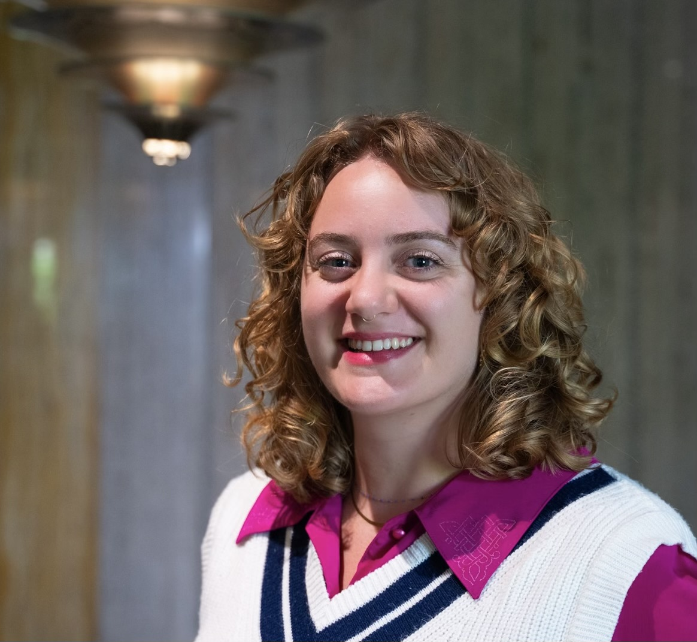

## About me

Hello!

I am research fellow in population mental health. I am based at the Centre for Longitudinal Studies at University College London (UCL) with a PhD in Social, Genetic, and Developmental Psychology from King’s College London.

I committed to open, diverse, and communicable science.

{fig-align="center" width="250px"}

## Connect

[GitHub](https://github.com/knthompson26)

[Google Scholar](https://scholar.google.co.uk/citations?hl=en&user=xD4dn1IAAAAJ)

[LinkedIn](https://www.linkedin.com/in/katherine-thompson-79a60b390/)

[Bluesky](https://bsky.app/profile/ktnthompson.bsky.social)

[ORCID](https://orcid.org/0000-0003-1818-0428)

[Open Science Framework](https://osf.io/r58nz/)
